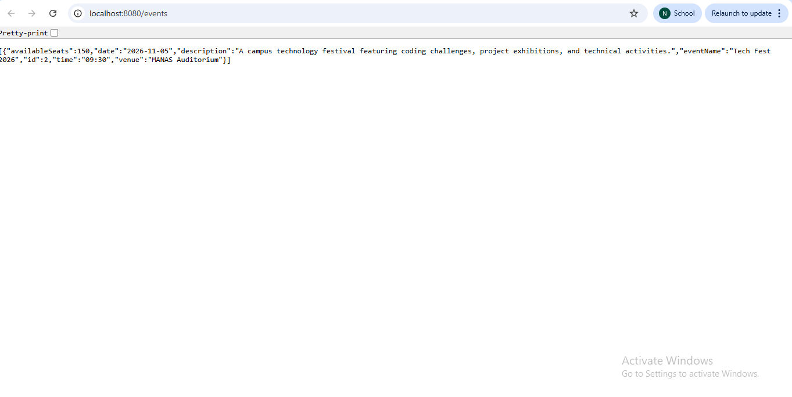
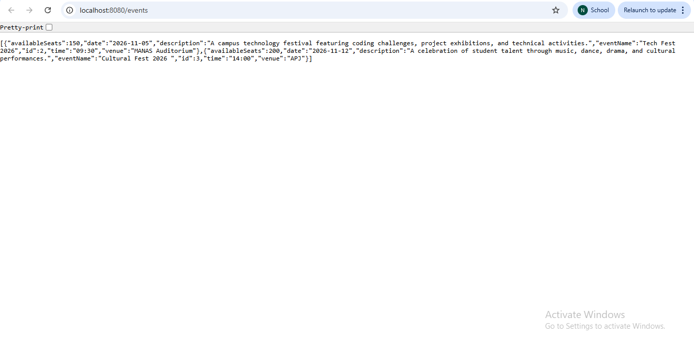

# CampusConnect – Backend

## Overview
The CampusConnect backend is developed using Java Spring Boot to manage campus event information. It provides REST APIs that allow the frontend to create, retrieve, update, and delete event details.

## Technologies Used
- Java
- Spring Boot
- Spring Data JPA
- MySQL
- Maven
- REST APIs

## Features
- Create a new event
- Retrieve all events
- Retrieve an event by ID
- Update existing event details
- Delete an event
- Store event data in MySQL

## Project Architecture
The backend follows a layered architecture:

- **Entity:** Represents the event data.
- **Repository:** Handles database operations.
- **Service:** Contains application logic.
- **Controller:** Exposes REST API endpoints.

## API Endpoints

| Method | Endpoint | Operation |
|---|---|---|
| GET | `/events` | Retrieve all events |
| GET | `/events/{id}` | Retrieve an event by ID |
| POST | `/events` | Create an event |
| PUT | `/events/{id}` | Update an event |
| DELETE | `/events/{id}` | Delete an event |

## Database
MySQL is used to store event details, including event name, date, time, venue, description, and available seats.

## Backend Screenshot
### 1. Backend API Response

### 2. Delete Event

### 3. Edit Event

## Conclusion
This backend demonstrates CRUD operations, REST API development, and database integration using Java Spring Boot and MySQL.
